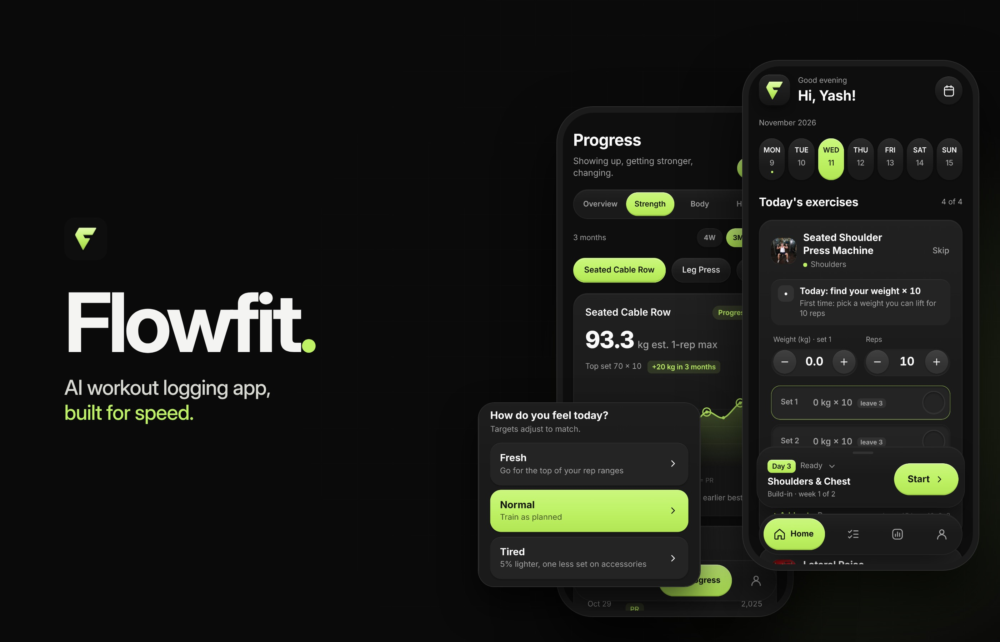

# Flowfit



Flowfit is a workout logging app built for speed. Open it, log your set, put the phone down. It runs as an Android app (built with Capacitor) and works fully offline.

## Features

- Today's workout opens automatically from your split
- Log weight and reps with plus and minus buttons, then tap how the set felt
- Next-weight suggestions based on your reps and effort
- Rest timer with a lock-screen notification on Android
- Training phases (build, progress, push, deload) that set how hard each set should be
- Import a plan from plain text, like `Bench Press 4x8`
- Progress charts: estimated 1-rep max, PRs, bodyweight average, sets per muscle
- Consistency grid and streaks that allow rest days
- Optional AI coach powered by Groq (free) or Claude — just paste either API key
- Backup and restore, plus a second copy saved in Android storage

## AI coach and privacy

The coach is optional. To use it, create a free key at [console.groq.com](https://console.groq.com) and paste it in Profile → AI Coach. The key is stored only on your device and is never included in backups. Training data is sent to Groq only when you use a coach feature. Without a key, the app's built-in rules do everything.

Exercise pictures are loaded from public exercise databases when you're online.

## Get the APK

Every push to this repo builds a debug APK with GitHub Actions. Open the **Actions** tab, pick the latest green run and download **flowfit-apk** from Artifacts. Install it on your phone (you'll need to allow installs from unknown sources once).

## Build it yourself

You need Node.js 20+ and Android Studio (it includes the Android SDK and JDK 21).

```
npm install
npx cap add android
npx capacitor-assets generate --android
npx cap sync android
npx cap open android
```

Then use Build ▸ Build APK(s) in Android Studio, or press Run with your phone plugged in. After changing anything in `www/`, run `npx cap sync android` again.

You can also open `www/index.html` in a browser to try the app, though Android-only features like notifications and haptics won't work there.

## Project structure

```
www/index.html          The whole app: UI, logic and storage
www/native-bridge.js    Android features (haptics, notifications, back button, storage)
assets/                 Icon and splash source images
capacitor.config.json   App id, name and plugin settings
.github/workflows/      APK build
```

## Notes

- The build is a debug APK, fine for personal use. A Play Store release needs a signed build.
- On phones with aggressive battery saving, the rest notification can arrive a few seconds late.

## License

[MIT](LICENSE) © Yashas Tej CM
